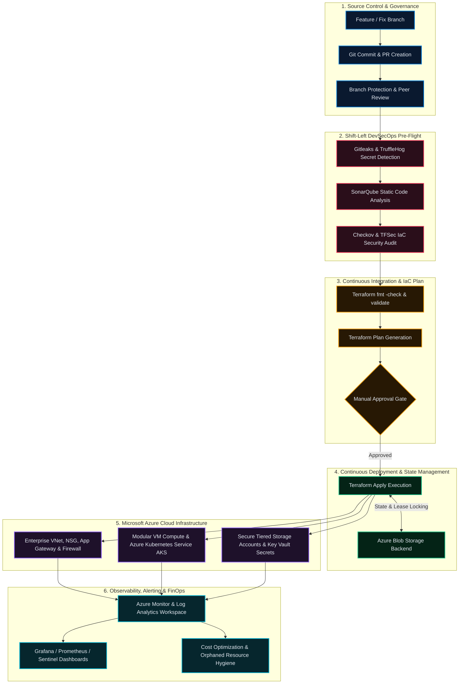

<div align="center">



<br/><br/>

<a href="https://www.linkedin.com/in/ashish-pandey-05120a30">
  
</a>

<br/>

<a href="https://readme-typing-svg.demolab.com/">
  
</a>

### ⚡ Senior DevOps Engineer | Cloud, IaC & DevSecOps Specialist
**Reliance Industries Ltd. • 10+ Years Total IT • 5+ Years Cloud Automation & CI/CD**

[](https://www.linkedin.com/in/ashish-pandey-05120a30)
[](mailto:ap61084@gmail.com)
[](https://github.com/Ashish09071991?tab=repositories)
[](#-professional-journey)
[](#-get-in-touch)

</div>

---

## 💼 Executive Profile

I am a **Senior DevOps Engineer** with **10+ years of comprehensive IT experience**, including **5+ years specializing in cloud infrastructure automation, CI/CD pipelines, and DevSecOps practices**. 

Currently at **Reliance Industries Ltd.**, I drive infrastructure engineering and release automation for high-impact platforms, including the business-critical **Reliance Jio POS application** (handling SIM activation, billing, and inventory management). My hands-on core spans **Terraform modular IaC**, **Microsoft Azure enterprise cloud**, **Azure DevOps & GitHub Actions multi-stage YAML pipelines**, **Kubernetes (AKS)**, and **shift-left pipeline security**.

### 🚀 Business Impact & Proven Metrics:
* 📉 **60% Reduction in Manual Effort:** Delivered through standardized, reusable Terraform modules and automated PowerShell/Bash orchestration.
* ⚡ **40% Faster Deployment Cycles:** Designed streamlined multi-stage CI/CD pipelines across Dev, Staging, and Production tiers.
* 🛡️ **99.9% Production Uptime:** Sustained high-availability architectures and zero/low-downtime release deployments for enterprise platforms.
* 🔒 **Shift-Left Security Enforcement:** Embedded automated static analysis, container scanning, and secret detection directly into pipelines.

<br/>

<div align="center">

| 🏢 **Enterprise Foundation** | 🚀 **Cloud & DevOps Core** | 📦 **Modular IaC & GitOps** | 🛡️ **Shift-Left DevSecOps** |
| :--- | :--- | :--- | :--- |
| **10+ Years** enterprise IT experience across Linux (RHEL/CentOS/Ubuntu), network routing, systems engineering, and operational reliability. | **5+ Years** architecting and managing production workloads on **Microsoft Azure**, Azure DevOps, and GitHub Actions. | Production **Terraform** using parent-child modules, `for_each`, `map(object)`, and remote state lease locking. | Pipeline security scanning via **SonarQube, Trivy, Checkov, TFSec, TruffleHog, and Gitleaks**. |

</div>

---

## 🏗️ Enterprise Production DevOps & Security Lifecycle



---

## 🛠️ Comprehensive Technical Arsenal

<div align="center">

<a href="https://skillicons.dev">
  
</a>

</div>

<br/>

| Technical Domain | Enterprise Technologies & Tools |
| :--- | :--- |
| ☁️ **Cloud Platforms** | **Microsoft Azure** (Virtual Machines, VNet, NSG, Storage Accounts, Key Vault, Load Balancer, Application Gateway, Azure Firewall, Azure Monitor), **AWS (Basics)** |
| 📦 **Infrastructure as Code** | **Terraform** (Reusable Child/Parent Modules, `for_each`, `map(object)`, `dynamic` blocks, Remote State Backend Locking), **ARM Templates**, **Bicep** |
| 🚀 **CI/CD & DevOps** | **Azure DevOps (ADO)** (Multi-stage YAML Pipelines, Environments, Service Connections), **GitHub Actions**, **Azure Repos** |
| 🛡️ **DevSecOps & Scanning** | **SonarQube**, **Trivy**, **Checkov**, **TFSec**, **TruffleHog**, **Gitleaks**, **OWASP Dependency Check** |
| 🐳 **Containers & Orchestration** | **Docker**, **Kubernetes (AKS)**, **Helm Charts** |
| 📊 **Monitoring & Observability** | **Azure Monitor**, **Log Analytics Workspace**, **Grafana**, **Prometheus**, **ELK Stack**, **Microsoft Sentinel** |
| 🔐 **Identity & Governance** | **Azure AD / Microsoft Entra ID**, Role-Based Access Control (**RBAC**), **Azure Key Vault**, **Azure Policy**, Cloud FinOps & Cost Optimization |
| 📜 **Scripting & Automation** | **PowerShell**, **Bash**, **Azure CLI (`az cli`)**, Cron automation |
| 🖥️ **Operating Systems & Systems** | **Linux** (RHEL, CentOS, Ubuntu), **Windows Server**, LVM Storage, Apache, Nginx, DNS, SSH |

---

## 💼 Professional Experience & Enterprise Track Record

```
2013 ─── IT & Network Support (Wipro / IKYA / Emerson) ─── Enterprise Systems & L1/L2 Infrastructure
2016 ─── System Engineer (Staunch Business Solutions)  ─── Linux Server Administration & Scripting
2020 ─── DevOps Consultant (Staunch Business Solutions)─── Azure Cloud, Terraform IaC & CI/CD
2023 ─── Senior DevOps Engineer (Reliance Industries)  ─── Enterprise Cloud, DevSecOps, Jio POS
```

### 🏢 Reliance Industries Ltd., India
**Senior DevOps Engineer** | *Mar 2023 – Present*
* **Flagship Enterprise Platform:** Lead DevOps engineering for the mission-critical **Reliance Jio POS application** — powering nationwide SIM activation, customer billing, and live inventory management with zero/low-downtime releases and **99.9% application uptime**.
* **Terraform Modularization:** Architect and maintain standardized, reusable Terraform modules with remote state management in Azure Blob Storage, eliminating manual provisioning effort by **60%**.
* **Enterprise CI/CD Pipelines:** Design and operate multi-stage YAML pipelines across Azure DevOps and GitHub Actions, speeding up release cycles by **40%**.
* **Embedded DevSecOps:** Integrated automated pre-deployment scanning (Terraform validation, SonarQube quality gates, Trivy container analysis, and Gitleaks secret detection).
* **Observability & FinOps:** Implemented continuous health telemetry with Azure Monitor and Log Analytics, optimizing cloud resource usage to cut unnecessary cloud expenditure.

---

### 🏢 Staunch Business Solutions, India
**DevOps Consultant** | *Jan 2020 – Feb 2023*
* Delivered end-to-end infrastructure automation on Azure using Terraform for VMs, VNets, Storage Accounts, and Load Balancers.
* Configured enterprise network isolation via VNet peering, NSG security rules, and Load Balancer routing.
* Built automated build and release pipelines with Azure DevOps and GitHub Actions.
* Designed backup and Disaster Recovery (DR) strategies leveraging Azure Backup and Recovery Services Vault.

**System Engineer** | *Nov 2016 – Dec 2019*
* Managed high-availability Linux production servers (RHEL, CentOS, Ubuntu) running Apache, Nginx, SSH, and DNS.
* Automated administrative workflows, backups, and log rotations using Bash shell scripting and cron jobs.
* Managed LVM storage volumes and resolved critical system incidents to minimize server downtime.

---

## 🏆 Awards & Honors

* 🌟 **Quarterly Star Performer (2025)** — *Reliance Industries Ltd.*
  *Awarded for exceptional CI/CD multi-stage pipeline optimization and release stabilization.*
* 🥇 **Annual Excellence Award (2024)** — *Reliance Industries Ltd.*
  *Recognized for enterprise Terraform modularization, cutting infrastructure manual provisioning effort by 60%.*
* 🎯 **Team Excellence Award (2024)** — *Reliance Industries Ltd.*
  *Honored for sustaining 99.9% application uptime across business-critical production environments.*

---

## 📂 Featured GitHub Implementations

Direct links to open-source infrastructure and automation implementations from my workspace:

### 1. 🏗️ [`azure-enterprise-landing-zones`](https://github.com/Ashish09071991/azure-enterprise-landing-zones)
**Enterprise Azure Landing Zone Infrastructure as Code**
* Modular, scalable Terraform codebase delivering enterprise Hub-and-Spoke network topology.
* Provisions segregated subnets, route tables, NSGs, and remote state backend locking with Azure Blob Storage.
* [**Explore Repository ➜**](https://github.com/Ashish09071991/azure-enterprise-landing-zones)

---

### 2. ☸️ [`azure-kubernetes-aks-terraform-iac`](https://github.com/Ashish09071991/azure-kubernetes-aks-terraform-iac)
**Production Azure Kubernetes Service (AKS) Architecture**
* Enterprise AKS cluster deployment with dedicated System & User autoscaling node pools.
* Configured with Azure CNI networking, Managed Identity, and Azure Log Analytics container observability.
* [**Explore Repository ➜**](https://github.com/Ashish09071991/azure-kubernetes-aks-terraform-iac)

---

### 3. 🛡️ [`devsecops-pipeline-security-framework`](https://github.com/Ashish09071991/devsecops-pipeline-security-framework)
**Enterprise DevSecOps CI/CD Pipeline Security Framework**
* Shift-Left security automation integrating Checkov, TFSec, Trivy, and Gitleaks pre-flight gates.
* Ready-to-use pipeline definitions for both GitHub Actions and Azure DevOps YAML multi-stage workflows.
* [**Explore Repository ➜**](https://github.com/Ashish09071991/devsecops-pipeline-security-framework)

---

### 4. 📦 [`terraform-azure-storage-account-dynamic`](https://github.com/Ashish09071991/terraform-azure-storage-account-dynamic)
**Declarative Multi-Resource Automation using `for_each` & `map(object)`**
* Advanced Terraform construct implementation driving multi-region Resource Group and Storage Account provisioning from a single structured map.
* Enforces standardized naming conventions, tiering policies, and security configurations.
* [**Explore Repository ➜**](https://github.com/Ashish09071991/terraform-azure-storage-account-dynamic)

---

### 5. 🖥️ [`terraform-azure-vm-modules`](https://github.com/Ashish09071991/terraform-azure-vm-modules)
**Parent-Child Modular Compute Engine Architecture**
* Enterprise Terraform pattern establishing clean decoupling between orchestrator root modules and reusable child compute modules.
* Dynamic NIC configuration, disk attachment profiles, and secure access management.
* [**Explore Repository ➜**](https://github.com/Ashish09071991/terraform-azure-vm-modules)

---

### 6. ⚡ [`azure-devops-yaml-ci-cd-pipelines`](https://github.com/Ashish09071991/azure-devops-yaml-ci-cd-pipelines)
**Enterprise Multi-Stage CI/CD Deployment Integration**
* Multi-stage build, test, and release workflow with automated validation checks and deployment stages.
* Integrated approval gates and environment-specific variable substitutions.
* [**Explore Repository ➜**](https://github.com/Ashish09071991/azure-devops-yaml-ci-cd-pipelines)

---

### 7. 🤖 [`github-actions-devsecops-workflows`](https://github.com/Ashish09071991/github-actions-devsecops-workflows)
**Automated DevSecOps & IaC Verification Workflow**
* GitHub Actions workflow triggering automated `terraform fmt`, `terraform validate`, and linting scans on pull requests.
* Secure credential injection via GitHub Secrets and Azure Service Principal authentication.
* [**Explore Repository ➜**](https://github.com/Ashish09071991/github-actions-devsecops-workflows)

---

### 8. 💰 [`azure-finops-cost-governance`](https://github.com/Ashish09071991/azure-finops-cost-governance)
**FinOps Automation & Cloud Governance Engine**
* Automated scripts and runbooks to identify unattached managed disks, idle public IPs, and unused resources.
* Enforces enterprise resource tagging hygiene and cost governance across Azure subscriptions.
* [**Explore Repository ➜**](https://github.com/Ashish09071991/azure-finops-cost-governance)

---

## 📊 GitHub Analytics

<div align="center">


</div>

---

## 🤝 Let's Connect

I am always keen to connect with fellow DevOps engineers, cloud architects, and engineering leaders.

<div align="center">

[](https://www.linkedin.com/in/ashish-pandey-05120a30)
[](mailto:ap61084@gmail.com)
[](https://github.com/Ashish09071991)

<br/>


</div>
